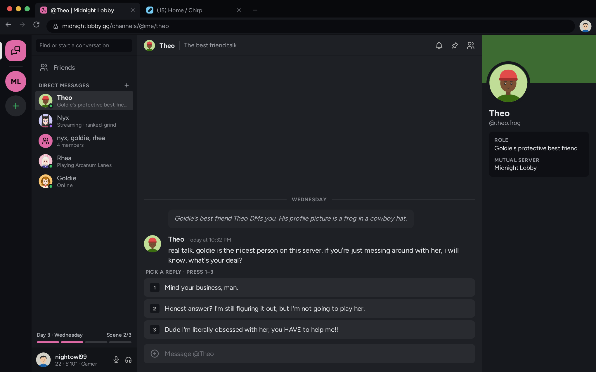
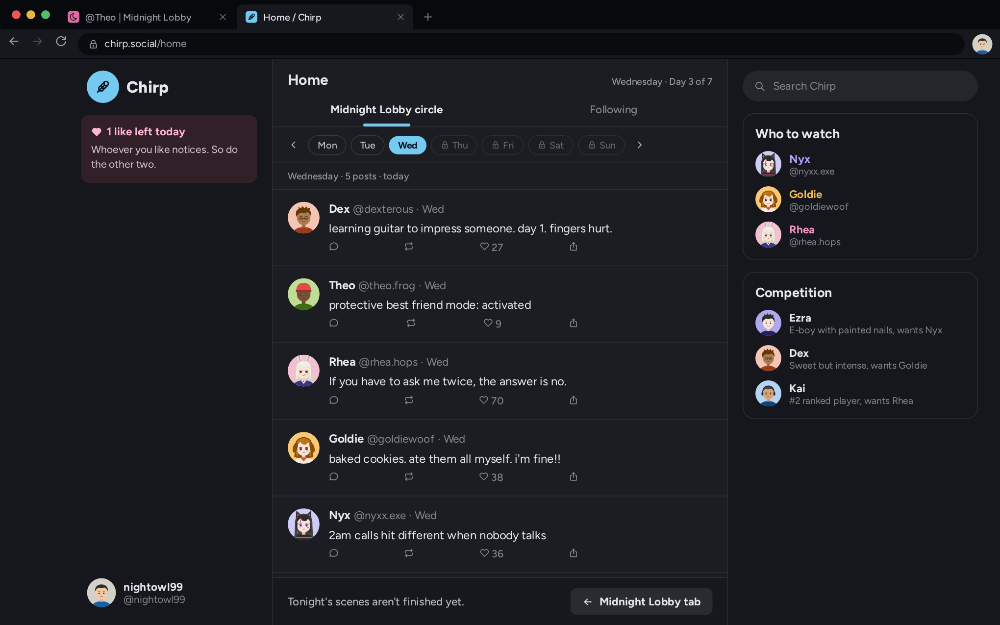

# Midnight Lobby

A week-long dating sim that plays out entirely inside a fake gaming chat server. Built with React and TypeScript, with a pure game engine and no backend.

**[Play it in your browser](https://midnightlobby.hellotulio.com/)** (about 15 minutes for a quick run, no account needed)



## What it is

You're the new guy on Midnight Lobby, a gaming server full of e-dating drama. Over seven days you talk in voice channels and DMs, queue ranked, like posts on a parody social feed, and try to win over one of three love interests without getting caught flirting with the others.

The joke is that it takes internet romance completely seriously. Matching profile pictures are a major commitment, and an all-night sleep call is the most intimate thing in the game. It's a PG-13 comedy, and every character, game and platform in it is made up.

> "please lower your volume. emotionally." — Nyx
>
> "Insecurity isn't cute. It's lag." — Rhea

The whole game is presented as a fake desktop: a chat client, a browser and a social feed, with all the art drawn in code as SVG. On a phone, it collapses into a single chat screen with slide-out panels.



## Gameplay

- **21 scenes across 7 days**, with 99 choices. Some scenes change depending on how a character feels about you.
- **Three love interests who want different things.** The reply that charms one can cost you with another, and affection stays hidden.
- **Evening activities:** queue a game or watch something together, then unlock matching pfps and sleep calls as trust grows.
- **Friends and rivals who matter.** Best friends can vouch for you or warn her off, and each love interest has a rival competing for her.
- **Consequences:** two-timing gets noticed, and lying in a confrontation is the worst thing you can do. Each love interest has three endings.

## How it's built

The goal was a structure where adding a character or scene means adding a content file, not changing the engine or UI.

| Layer | Responsibility |
| --- | --- |
| `src/engine` | Pure TypeScript rules and state. No React. Content is passed in. |
| `src/content` | All characters, scenes, posts and endings as typed data, checked by a validator. |
| `src/app` | React provider, timers, and a session reducer that wraps the game reducer. |
| `src/ui` | Components that read state and dispatch actions. No game rules. |

Some decisions I'd point to:

- **Boundaries are enforced, not just documented.** ESLint `no-restricted-imports` makes `npm run lint` fail if the engine imports React or the UI.
- **Reducers stay pure because randomness lives in state.** A seeded RNG is stored in `GameState`, so full playthroughs are reproducible in tests and the reducer is safe under React StrictMode.
- **Scenes are scheduled, not hard-coded.** A scheduler picks the highest-priority scene whose conditions pass, so scenes can be triggered by earlier choices through flags.
- **Content is TypeScript, not JSON.** Conditions and dynamic lines are real functions, and content validation runs as a normal test.
- **The game began as one large HTML file.** It was ported in phases with tests pinning the shipped content, and quirks were kept and written down rather than silently changed.

The reasoning behind these, including what was rejected, is in [docs/DECISIONS.md](docs/DECISIONS.md).

## Built with AI

I built this with Claude Code as a fun project and an exercise in directing AI on something bigger than a single prompt. I owned the concept, design and architecture decisions and reviewed the work. Claude did most of the implementation.

Most of the effort went into giving it the right constraints:

- [CLAUDE.md](CLAUDE.md) sets the architecture rules and working style.
- [docs/STYLE.md](docs/STYLE.md) defines each character's voice, the content limits and the balance scale.

## Tech stack

React 19, TypeScript, Vite, Vitest, ESLint, Tabler Icons. State is `useReducer` over a pure engine, with plain CSS and no state library. Hosted on Cloudflare.

## Running it locally

Requires Node 22.

```bash
npm install
npm run dev
```

| Command | What it does |
| --- | --- |
| `npm run build` | Production build |
| `npm run test` | Vitest suite |
| `npm run typecheck` | TypeScript checks |
| `npm run lint` | ESLint, including the architecture boundaries |

## What's next

The game is still growing. Planned work includes:

- **Player gender choice**, which changes who the love interests are
- **Bigger side characters**, with more interactions and more impact on how the story plays out
- **Save and load**, so a run can be continued later

The full list is in the [roadmap](docs/ROADMAP.md).

## More docs

- [Adding content](docs/ADDING_CONTENT.md): how to add characters, scenes and activities
- [Port notes](docs/PORT_NOTES.md): quirks kept on purpose and how the port was verified

## License

© 2026 Tulio Contramaestre. All rights reserved. The source is public to read, but it isn't licensed for reuse.
